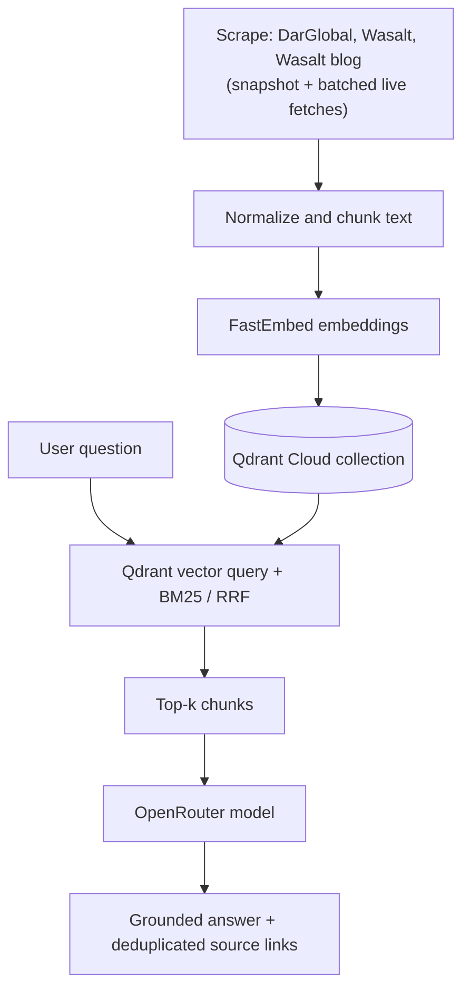

# DarGlobal & Wasalt Assistant

[](https://www.python.org/)
[](https://fastapi.tiangolo.com/)
[](https://qdrant.tech/)
[](https://www.docker.com/)
[](https://render.com/)

A production-style retrieval-augmented (RAG) chatbot that answers questions about **DarGlobal** and **Wasalt** strictly from the content of their public websites. Every answer is grounded in retrieved context and links back to the pages it came from. When the indexed data does not cover a question, the assistant says so instead of guessing.

**Live demo:** [https://darglobal-chatbot-fhf9.onrender.com](https://darglobal-chatbot-fhf9.onrender.com/)

---

## Table of contents

- [Highlights](#highlights)
- [Example questions](#example-questions)
- [How it works](#how-it-works)
- [Architecture](#architecture)
- [Data sources](#data-sources)
- [Keeping data up to date](#keeping-data-up-to-date)
- [Tech stack](#tech-stack)
- [API reference](#api-reference)
- [Quick start](#quick-start)
- [Configuration](#configuration)
- [Project structure](#project-structure)
- [Design decisions](#design-decisions)
- [Known limitations](#known-limitations)
- [Deliverables](#deliverables)

---

## Highlights

| Capability | Description |
| --- | --- |
| **Grounded answers** | Responses are generated only from scraped website content. If the answer is not in the data, the assistant replies: *"I don't have that information in my data about DarGlobal and Wasalt."* |
| **Verifiable sources** | The model cites numbered context blocks (`[n]`); the backend deduplicates them and returns the exact source URLs used. |
| **Hybrid retrieval** | Dense vector search (`all-MiniLM-L6-v2` via FastEmbed) against Qdrant Cloud, fused with BM25 keyword scoring using Reciprocal Rank Fusion (RRF). |
| **Batched live refresh** | `BatchRefreshScheduler` refreshes content in configurable batches (`BATCH_SIZE`, `NUM_BATCHES`, `BATCH_GAP_MIN`, `BATCH_REFRESH_INTERVAL_MIN`) using conditional requests (`ETag` / `Last-Modified`), content hashing and progress logging. |
| **Safe updates** | Failed or abnormally small scrapes never overwrite good records. Chunks are upserted to Qdrant without holding a large vector index in memory. |
| **Resilient generation** | Provider access through [OpenRouter](https://openrouter.ai) with a configurable primary model and automatic fallback models. |
| **Responsible crawling** | Honors `robots.txt`, applies request delays and page-size caps, and identifies itself with a clear `User-Agent`. |

## Example questions

- What does DarGlobal do?
- What is Wasalt?
- What projects does DarGlobal have in Oman?
- What perks come with owning an AIDA residence?

Questions the public sites do not answer (for example exact registration fees or projected yields) receive the explicit *"I don't have that information in my data about DarGlobal and Wasalt."* response rather than a fabricated answer.

## How it works



## Architecture

```text
+-------------------------------------------------------------------+
|                         Public Web Sources                        |
|  - darglobal.co.uk (English sitemap + crawl)                      |
|  - wasalt.sa (English sitemap + crawl; listings/login/pay skip)   |
|  - blog.wasalt.sa (WordPress REST API + live page fetches)        |
+-------------------------------------------------------------------+
                                  |
                                  v
+-------------------------------------------------------------------+
|             Scraping & Refresh Layer (app/scraper.py,             |
|             app/refresh.py, app/batch_runner.py, app/store.py)    |
|  - Respects robots.txt, request delays & MAX_PAGE_BYTES           |
|  - Batched live page fetches (BATCH_SIZE / NUM_BATCHES)           |
|  - Change detection: ETag / Last-Modified + SHA-256 text hash     |
|  - Local snapshot & seed support (runtime/pages.json, seed/)      |
+-------------------------------------------------------------------+
                                  |
                                  v
+-------------------------------------------------------------------+
|             Indexing & Retrieval Layer (app/indexer.py,           |
|             app/nlp_processor.py)                                 |
|  - Text normalization, lemmatization & chunking                   |
|  - Local embeddings via FastEmbed ONNX (all-MiniLM-L6-v2)         |
|  - Qdrant Cloud storage + BM25 reranking via RRF                  |
+-------------------------------------------------------------------+
                                  |
                                  v
+-------------------------------------------------------------------+
|             Generation & API Layer (app/main.py, app/rag.py,      |
|             app/scheduler.py, app/static/index.html)              |
|  - FastAPI + Uvicorn + BatchRefreshScheduler                      |
|  - Endpoints: GET /, POST /chat, GET /health, GET /status,        |
|    POST /refresh (X-Refresh-Token)                                |
|  - OpenRouter primary model + automatic fallback models           |
|  - Grounded answer + source links (or "I don't have that          |
|    information in my data about DarGlobal and Wasalt.")           |
+-------------------------------------------------------------------+
                                  ^
                                  | runs on
+-------------------------------------------------------------------+
|                 Hosting & Optional Keep-Alive                     |
|  - Docker container deployed on Render                            |
|  - Optional cloudflare-cron/ worker pinging /health               |
+-------------------------------------------------------------------+
```

### Key architectural details

- **Low-memory retrieval via Qdrant Cloud:** `QdrantIndex` queries Qdrant Cloud with locally computed FastEmbed query vectors and fuses the dense ranking with BM25 scores via RRF, so the application never needs to hold the full vector index in RAM.
- **Batched background refresh:** On startup, `app/main.py` runs `R.load_initial()` and starts `BatchRefreshScheduler` (`app/scheduler.py`) with `build_batch_runner` (`app/batch_runner.py`). `/health` can trigger a due batch as a safety net, and `POST /refresh` allows authenticated manual triggers.
- **Stateless container, durable data:** Container disk is treated as ephemeral. Durability comes from Qdrant Cloud and an optional committed `seed/pages.json` snapshot, so redeploys and restarts do not lose indexed knowledge.

## Data sources

| Source | Method |
| --- | --- |
| DarGlobal (`darglobal.co.uk`) | English pages via sitemap and link crawl |
| Wasalt (`wasalt.sa`) | English pages via sitemap and link crawl; property listings, login and payment pages are skipped |
| Wasalt blog (`blog.wasalt.sa`) | WordPress REST API and live per-page fetches during batch updates |

The scraper respects `robots.txt`, enforces request delays and byte-size caps (`MAX_PAGE_BYTES`), logs live page fetches and batch progress, and identifies itself with a clear `User-Agent`.

## Keeping data up to date

| Mechanism | Behavior |
| --- | --- |
| Batched refresh | Runs in batches (`BATCH_SIZE`, `NUM_BATCHES`) spaced by `BATCH_GAP_MIN`, repeating every `BATCH_REFRESH_INTERVAL_MIN` |
| Safety net | `/health` triggers a batch when none is running and the refresh interval has elapsed |
| Manual refresh | `POST /refresh` with the `X-Refresh-Token` header |
| Keep-alive (optional) | A Cloudflare Workers cron in `cloudflare-cron/` pings `/health` to keep the instance warm |

Change detection combines conditional requests (`ETag` / `Last-Modified`) with a SHA-256 hash of each page's text, so unchanged pages are never re-embedded.

## Tech stack

| Layer | Choice |
| --- | --- |
| Backend | FastAPI, Uvicorn |
| Scraping | `requests`, BeautifulSoup, `lxml` |
| Embeddings | `sentence-transformers/all-MiniLM-L6-v2` via FastEmbed (ONNX, runs locally) |
| Vector DB & search | Qdrant Cloud (`qdrant-client`) + BM25 with Reciprocal Rank Fusion |
| LLM access | OpenRouter, configurable primary and fallback models |
| UI | Single static page (`app/static/index.html`) |
| Packaging | Docker |
| Hosting | Render |

## API reference

| Endpoint | Purpose |
| --- | --- |
| `GET /` | Chat interface |
| `POST /chat` | Ask a question. Body: `{"message": "...", "history": []}` |
| `GET /health` | Liveness check (also triggers a due batch refresh when idle) |
| `GET /status` | Batch states, last refresh time, chunks per source, last result |
| `POST /refresh` | Trigger a batch refresh (`?batch_index=...`). Requires the `X-Refresh-Token` header |

**Example request**

```bash
curl -X POST http://localhost:7860/chat \
  -H "Content-Type: application/json" \
  -d '{"message": "What is Wasalt?", "history": []}'
```

## Quick start

### Prerequisites

- Python 3.11
- An [OpenRouter](https://openrouter.ai) API key
- A [Qdrant Cloud](https://qdrant.tech/) cluster URL and API key

### Run locally

**PowerShell (Windows)**

```powershell
python -m venv venv
.\venv\Scripts\Activate.ps1
pip install -r requirements.txt

Copy-Item .env.example .env
# Set OPENROUTER_API_KEY, QDRANT_URL, QDRANT_API_KEY, and REFRESH_TOKEN in .env

python -m app.cli dry-run --limit 4
python -m app.cli scrape
python -m app.cli ask "What is Wasalt?"
uvicorn app.main:app --port 7860
```

**Bash (macOS / Linux)**

```bash
python -m venv venv && source venv/bin/activate
pip install -r requirements.txt

cp .env.example .env
# Set OPENROUTER_API_KEY, QDRANT_URL, QDRANT_API_KEY, and REFRESH_TOKEN in .env

python -m app.cli dry-run --limit 4
python -m app.cli scrape
python -m app.cli ask "What is Wasalt?"
uvicorn app.main:app --port 7860
```

Then open `http://localhost:7860`.

### Run with Docker

```bash
docker build -t darglobal-bot .
docker run --rm -p 7860:7860 --env-file .env --name darglobal-bot darglobal-bot
```

### Deploy on Render

1. Create a **Web Service** on [Render](https://render.com/) and connect this repository.
2. Select **Docker** as the runtime and `main` as the branch.
3. Add the environment variables listed under [Configuration](#configuration).
4. Deploy, then open the generated URL.
5. Optional: set Render's health check path to `/health`.

## Configuration

| Variable | Required | Description |
| --- | --- | --- |
| `OPENROUTER_API_KEY` | Yes | OpenRouter API key |
| `QDRANT_URL` | Yes | Qdrant Cloud cluster URL |
| `QDRANT_API_KEY` | Yes | Qdrant Cloud API key |
| `QDRANT_COLLECTION` | No | Qdrant collection name (default `darglobal_wasalt`) |
| `REFRESH_TOKEN` | Recommended | Protects `POST /refresh` (`X-Refresh-Token`) |
| `MODEL_PRIMARY` | No | Primary OpenRouter model identifier (see `app/config.py` for the default) |
| `MODEL_FALLBACKS` | No | Comma-separated fallback model identifiers |
| `BATCH_SIZE` | No | Pages processed per batch (default `10`) |
| `NUM_BATCHES` | No | Total number of batches (default `100`) |
| `BATCH_GAP_MIN` | No | Minutes between scheduler loop ticks (default `60`) |
| `BATCH_REFRESH_INTERVAL_MIN` | No | Minutes before a batch is due for refresh (default `360`) |
| `CHUNK_MAX_CHARS` | No | Maximum characters per chunk (default `900`) |
| `CHUNK_OVERLAP` | No | Character overlap between chunks (default `120`) |
| `TOP_K` | No | Chunks returned per search query (default `7`) |

See `.env.example` for a ready-to-copy template.

## Project structure

```text
.
├── README.md
├── Dockerfile
├── requirements.txt
├── .dockerignore
├── .gitignore
├── .env.example
├── app/
│   ├── __init__.py
│   ├── main.py            FastAPI app and endpoints
│   ├── scheduler.py       BatchRefreshScheduler for periodic batch refreshes
│   ├── scraper.py         Crawling, robots.txt, live page fetch, change detection, blog API
│   ├── batch_runner.py    Runs batched live page fetches and chunk preparation
│   ├── refresh.py         Initial Qdrant load, batch helpers, and refresh state
│   ├── nlp_processor.py   Text normalization, lemmatization, and chunking
│   ├── indexer.py         FastEmbed embeddings, Qdrant Cloud upsert/search, BM25 + RRF
│   ├── rag.py             Prompting, OpenRouter calls with fallback, citation/source handling
│   ├── store.py           Snapshot storage helpers
│   ├── cli.py             dry-run / scrape / build / ask
│   ├── config.py          Settings and site definitions
│   └── static/
│       └── index.html     Chat UI
├── cloudflare-cron/       Optional keep-alive worker
│   ├── worker.js
│   └── wrangler.toml
└── seed/                  Optional snapshot directory (pages.json)
```

## Design decisions

- **Qdrant Cloud with local embeddings:** Vector storage is offloaded to Qdrant Cloud, while chunk and query embeddings are computed locally with FastEmbed. This removes a dependency on an external embedding API and keeps the container's memory footprint small.
- **Hybrid search:** Dense semantic ranking is merged with BM25 keyword scores via RRF, so queries containing exact terms such as project names, locations or features still surface the right chunks.
- **Attribution over assertion:** Marketing claims (rankings, projections, benefits) are presented as the companies' own statements, not as independent facts.
- **Refresh safety:** Failed scrapes, empty content or oversized responses fall back to the existing page records without overwriting good data.
- **Model resilience:** Generation goes through OpenRouter with ordered fallback models, so a single provider outage or rate limit does not take the assistant down.

## Known limitations

- The scheduler and in-memory rate limiter are designed for a **single application instance**; horizontal scaling would require moving that state to a shared store.
- Indexed content reflects public pages at the time of the last scrape and is refreshed incrementally, batch by batch.
- Model availability and rate limits depend on the upstream provider; fallback models are tried automatically when the primary is unavailable.
- Container disk is ephemeral. Persistence relies on Qdrant Cloud and, optionally, a committed `seed/pages.json` snapshot.
- On hosting plans that suspend idle instances, the first request after a period of inactivity may be slower. The optional keep-alive worker mitigates this.

## Deliverables

| Requirement | Implementation |
| --- | --- |
| Scrape public data from DarGlobal and Wasalt | `app/scraper.py` collects pages from both sites and the Wasalt blog |
| Build an AI chatbot using the collected data | Retrieval-augmented chatbot with sourced answers |
| Use a free OpenRouter model | Free OpenRouter model, configurable with fallbacks |
| Containerise with Docker | `Dockerfile` in this repository |
| Deploy, not only source code | Docker web service on Render |
| Provide a working URL | See [Live demo](#darglobal--wasalt-assistant) at the top |
